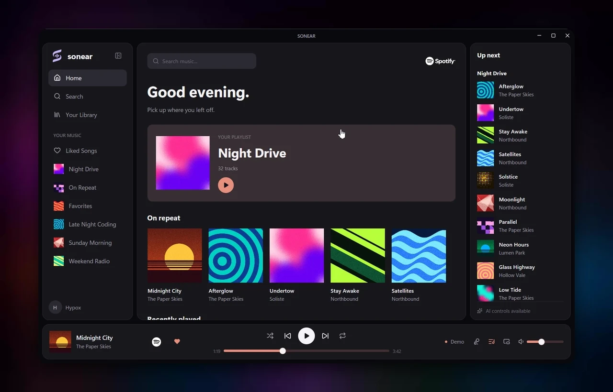
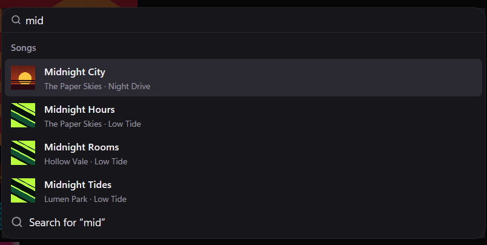
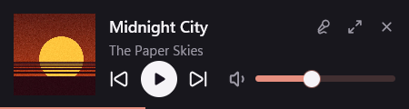

<p align="center">
  
</p>

<h1 align="center">Sonear</h1>

<p align="center">
  <strong>A native Spotify client for Windows, built in Rust.</strong>
</p>

<p align="center">
  <a href="https://sonear.hypox.studio">Website</a> ·
  <a href="#install">Install</a> ·
  <a href="#features">Features</a> ·
  <a href="#faq">FAQ</a> ·
  <a href="docs/legal/privacy.md">Privacy</a>
</p>

<p align="center">
  <a href="https://github.com/HypoxStudios/sonear/actions/workflows/ci.yml"></a>
  
  
  <a href="LICENSE"></a>
</p>



<p align="center"><sub>Demo mode, with made-up artists and artwork. Not affiliated with Spotify.</sub></p>

## Features

<table>
<tr><td><strong>Queue</strong></td><td>Drag, drop, remove, reorder.</td></tr>
<tr><td><strong>Radio</strong></td><td>Start Spotify's radio from any song or artist. The song you picked plays first.</td></tr>
<tr><td><strong>Ctrl+K</strong></td><td>Search, playback, navigation and Spotify links, all from one box. Every shortcut can be rebound.</td></tr>
<tr><td><strong>Synced lyrics</strong></td><td>Line by line, from <a href="https://lrclib.net">LRCLIB</a>. Click a line to jump to it.</td></tr>
<tr><td><strong>Color from the cover</strong></td><td>The whole app takes its accent from what's playing.</td></tr>
<tr><td><strong>Mini player</strong></td><td>Always on top. Resize it, fade it, or switch it to the lyrics. It never steals focus from a game.</td></tr>
<tr><td><strong>Tray and media keys</strong></td><td>Close the window and the music keeps going. Your keyboard and the Windows overlay still work.</td></tr>
<tr><td><strong>History</strong></td><td>A list of what you played.</td></tr>
</table>

<p align="center">
  
  &nbsp;
  
</p>

## Performance

| | CPU | Memory |
|---|---|---|
| Idle | **0.14%** | **39 MB** |
| Playing | **0.25%** | **41 MB** |
| In use | **0.87%** | **72 MB** |

<sub>Two-minute averages from a release build with a real Spotify account, on one Windows 11 machine with an i5-12500H and a 144 Hz display, as a share of the whole CPU, without Soloist. The app is 36 MB.</sub>

## Install

Sonear requires **Spotify Premium** and Windows 11.

Download the installer from the [latest release](https://github.com/HypoxStudios/sonear/releases/latest) and run it. It isn't signed yet, so Windows may warn you: choose **More info**, then **Run anyway**.

The first launch walks you through connecting your own [Spotify developer app](https://developer.spotify.com/dashboard) and installing [Soloist](https://developer.spotify.com/documentation/soloist), Spotify's official player.

To build from source, you need [Rust](https://rustup.rs) 1.92+, the Visual Studio C++ build tools and CMake:

```
git clone https://github.com/HypoxStudios/sonear
cd sonear
cargo run -p sonear --release
```

Just want a look? Demo mode needs no account:

```
cargo run -p sonear --features demo --target-dir target/demo
```

## FAQ

<details>
<summary><strong>Why do I need my own developer app?</strong></summary>

Spotify only gives wide API access to large companies, so you create your own app for personal use. It's free and takes a couple of minutes.

</details>

<details>
<summary><strong>What does it send, and where?</strong></summary>

Nothing goes to us. Sonear talks to Spotify, to LRCLIB while lyrics are showing, and to GitHub to check for updates, which you can turn off. **Settings → Delete all Sonear data** wipes everything. More in the [privacy policy](docs/legal/privacy.md).

</details>

<details>
<summary><strong>What are the limits?</strong></summary>

Mostly Spotify's:

- Soloist builds expire after 90 days. Sonear warns you and updates with one click.
- Followed playlists don't list their tracks, but they play fine, and Sonear fills them in as it hears them.
- Search shows 10 results per page, artist pages show albums only, and there are no recommendations.
- History starts from your last 50 plays and grows from there, without podcasts.
- Crossfade follows your Spotify account's setting, and Windows has no output device picker.

</details>

<details>
<summary><strong>Is it safe?</strong></summary>

Your login and keys live in Windows Credential Manager, and Soloist only listens on your own machine. Report security problems to <support@hypox.studio>.

</details>

<details>
<summary><strong>What's coming?</strong></summary>

An MCP server for your own tools, an assistant you can ask for music, and spoken intros between songs. All optional and off by default.

</details>

## Contributing

```
cargo fmt --all --check
cargo clippy --workspace --all-targets --all-features -- -D warnings
cargo test --workspace --all-features
```

`crates/soloist` runs the player, `crates/spotify` talks to the Web API, `crates/core` holds playback, queue and library logic, and `crates/app` is the GPUI interface.

## Credits

Built on [GPUI](https://github.com/zed-industries/zed) and [gpui-kit](https://crates.io/crates/gpui-kit), with lyrics from [LRCLIB](https://lrclib.net). Inspired by [Spotifast](https://github.com/crmne/spotifast) and [spotatui](https://github.com/LargeModGames/spotatui).

[Apache 2.0](LICENSE) · [Notice](NOTICE) · [End-user agreement](docs/legal/terms.md)

Questions? <support@hypox.studio>
